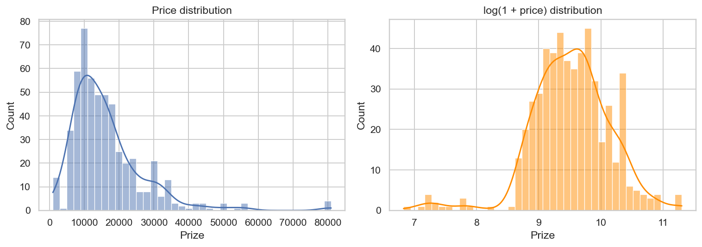
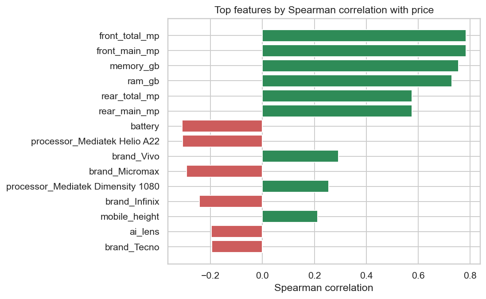
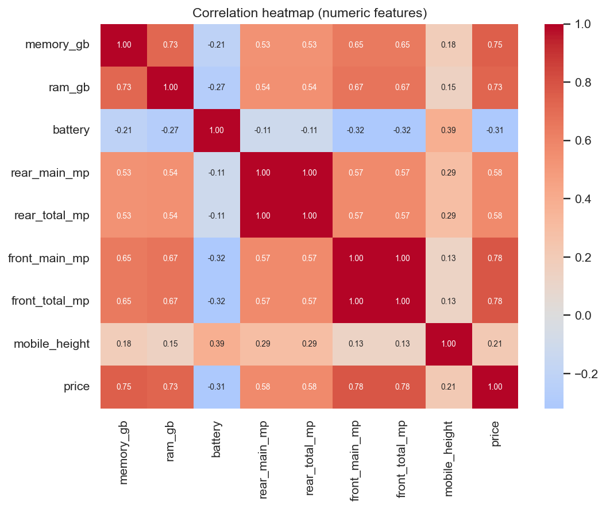
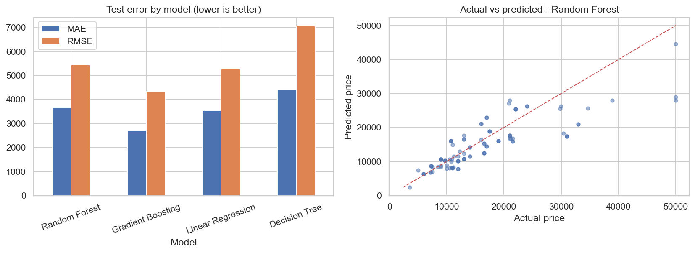
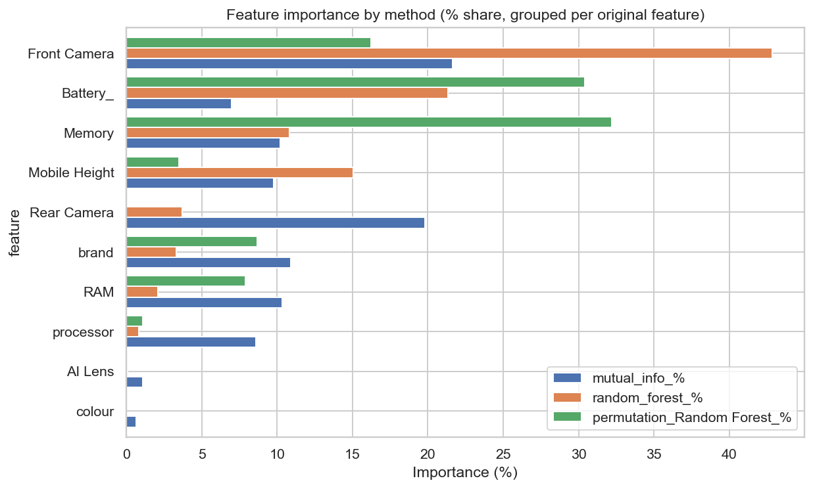

# Mobile Phone Price Prediction - Report

## 1. Data exploration
- Rows after removing 10 duplicate(s) and invalid prices: **531**
- Original columns: Model, Colour, Memory, RAM, Battery_, Rear Camera, Front Camera, AI Lens, Mobile Height, Processor_, Prize
- Target column: `Prize`  |  min 920, median 13,999, mean 16,306, max 80,999
- Columns with missing values: none
- Price is right-skewed, so models are trained on log(price) and predictions are converted back.

## 2. Preprocessing
- Text values were converted to numbers (GB/TB -> GB, mAh, inches, MP). Camera strings such as `48MP + 2MP` became main MP, lens count and total MP.
- AI lens became 0/1. Brand was extracted from the model name; brand, colour and processor were one-hot encoded (categories with fewer than 10 phones grouped as `Other`).
- Missing numeric values were median-imputed inside the model pipeline. Continuous features were clipped to the 1st-99th percentile of the training set to limit outliers.
- Train/test split: 80% / 20% (grouped by `Model` so every colour variant of a phone is on one side), random_state=42. Cross-validation uses the same grouping.

## 3. Feature extraction
Three views were combined: Spearman correlation, mutual information, and tree-based importance.

## 4. Models and evaluation
Metrics are on the held-out test set, in the same currency units as your price column.

| Model | MAE | RMSE | R2 | CV RMSE (train) |
|---|---|---|---|---|
| Random Forest | 3,661.510 | 5,440.130 | 0.663 | 6,558.702 |
| Gradient Boosting | 2,710.761 | 4,328.835 | 0.787 | 6,606.886 |
| Linear Regression | 3,548.677 | 5,265.178 | 0.685 | 6,775.774 |
| Decision Tree | 4,393.571 | 7,061.538 | 0.433 | 7,140.195 |

Best model by cross-validated RMSE: **Random Forest**.

## 5. Feature importance
| feature | mutual_info_% | random_forest_% | permutation_Random Forest_% | average_% |
|---|---|---|---|---|
| Front Camera | 21.7 | 42.8 | 16.2 | 26.9 |
| Battery_ | 7.0 | 21.3 | 30.4 | 19.6 |
| Memory | 10.2 | 10.8 | 32.2 | 17.7 |
| Mobile Height | 9.8 | 15.0 | 3.5 | 9.4 |
| Rear Camera | 19.8 | 3.7 | 0.0 | 7.8 |
| brand | 10.9 | 3.3 | 8.7 | 7.6 |
| RAM | 10.3 | 2.1 | 7.9 | 6.8 |
| processor | 8.6 | 0.8 | 1.1 | 3.5 |
| AI Lens | 1.1 | 0.1 | 0.0 | 0.4 |
| colour | 0.6 | 0.0 | 0.0 | 0.2 |

## 6. Recommendations
1. **Front Camera** - higher values go with higher prices (Spearman +0.78).
2. **Battery_** - lower values go with higher prices (Spearman -0.31).
3. **Memory** - higher values go with higher prices (Spearman +0.75).
4. **Mobile Height** - higher values go with higher prices (Spearman +0.21).
5. **Rear Camera** - higher values go with higher prices (Spearman +0.58).

- Use the top features as the backbone of price tiers: set price bands by those specs first, then adjust for brand positioning.
- Features near the bottom of the ranking add little pricing power; avoid charging a premium for them and avoid over-emphasising them in marketing.
- Use the saved model (`best_model.joblib`) to sanity-check new listings: a big gap between predicted and planned price flags a potential under- or over-pricing.
- Caveat: importance shows association, not causation, and depends on the dataset size and coverage.